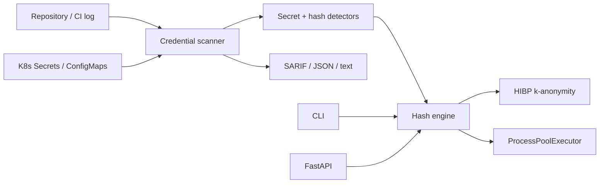

# Smart Hash Tool

**Cloud-native credential hygiene scanner: find plaintext secrets, weak hashes and reused passwords in repositories, CI logs and Kubernetes — plus a 12-format hash engine and REST API.**

[](https://github.com/GhostSN221/smart-hash-tool/actions/workflows/ci.yml)
[](https://github.com/GhostSN221/smart-hash-tool/actions/workflows/self-scan.yml)

During an audit, a CTF, or while reviewing a leaked dump, you usually start with a string like:

```text
5baa61e4c9b93f3f0682250b6cf8331b7ee68fd8
```

You do not know what it is, which tool to use, or which wordlist to pick. The usual loop — search, guess the length, configure hashcat/john, find a wordlist — takes **10–15 minutes before the first useful result**.

Smart Hash Tool removes that setup:

- detects 12 hash formats and common encodings;
- cracks in parallel across CPU cores, with optional mutation rules;
- checks SHA1 hashes against Have I Been Pwned using k-anonymity;
- generates all 12 supported hash formats from a plaintext;
- exposes the same functions through a FastAPI service.

> For authorized security audits, CTFs and lab work only. See the disclaimer at the end.

---

## What it does

| Capability | Details |
|---|---|
| Hash detection | MD5, NTLM, SHA1, RIPEMD160, SHA224, SHA256, SHA3-256, SHA384, SHA512, SHA3-512, MySQL323, CRC32 |
| Encoding detection | Base64 and hex, with false-positive guards |
| Parallel cracking | Multi-process dictionary attack across all CPU cores |
| Rule engine | 35 mutations per word: capitalization, l33t, suffixes, reverse |
| HIBP lookup | Privacy-preserving SHA1 prefix check |
| Generation | All 12 supported formats from one plaintext |
| Batch mode | One hash per line, JSON output |
| REST API | FastAPI with `/docs`, optional API key, wordlist sandbox |
| Repository scan | Plaintext credentials and weak hashes in files and CI logs |
| Kubernetes scan | Secrets and ConfigMaps in a namespace, with redaction |
| Reuse detection | Duplicate hashes and, with `--crack`, reused plaintext passwords |
| CI integration | SARIF output, GitHub Action, Code Scanning upload |
| CI | Tests, lint, Docker build, API/compose smoke and self-scan |

---

## Credential scanner

The scanner is the cloud-native front door of the project. It looks for the
things that usually slip through code review:

| Finding | Example | Severity |
|---|---|---|
| Plaintext cloud token | fake `AKIA…`, GitHub/Slack token, private key | error |
| Password literal | `db_password = …` | warning |
| Weak hash | MD5, NTLM, SHA1, RIPEMD160, MySQL323, CRC32 | warning |
| Strong hash candidate | SHA256/SHA3 candidate (for inventory) | note |
| Reused hash | same hash in multiple locations | warning |
| Reused password | same plaintext cracked for multiple hashes | error |

```bash
# Scan a repository
python credential_scanner.py --path . --format text

# SARIF for GitHub Code Scanning
python credential_scanner.py --path . --format sarif --out credential-scan.sarif

# Scan a CI log
python credential_scanner.py --file ci.log --format json

# Scan Kubernetes Secrets and ConfigMaps
python credential_scanner.py --k8s --namespace prod --format json

# Detect reused passwords (slower; capped at 20 hashes by default)
python credential_scanner.py --path . --crack --wordlist wordlist.txt
```

Plaintext secret values are **redacted** in findings. The scanner ignores hashes
shorter than 32 characters by default to avoid UUID/CRC32 false positives; use
`--min-hash-length 8` when you explicitly want CRC32/MySQL323 coverage.

### GitHub Action

```yaml
permissions:
  contents: read
  security-events: write

steps:
  - uses: actions/checkout@v4
  - uses: GhostSN221/smart-hash-tool@main
    with:
      path: .
      fail-on: error
  - uses: github/codeql-action/upload-sarif@v3
    with:
      sarif_file: credential-scan.sarif
```

The action writes SARIF, uploads nothing by itself, and fails the step according
to `fail-on`. The repository's own `Credential Hygiene` workflow runs this action
on every push and pull request.

---

## Quick start

```bash
git clone https://github.com/GhostSN221/smart-hash-tool
cd smart-hash-tool
pip install -r requirements.txt
```

### CLI

```bash
# Detect only
python3 smart_hash_cracker.py -s 5baa61e4c9b93f3f0682250b6cf8331b7ee68fd8

# Crack with the included wordlist
python3 smart_hash_cracker.py -s 5baa61e4c9b93f3f0682250b6cf8331b7ee68fd8 -w wordlist.txt

# Crack with mutation rules
python3 smart_hash_cracker.py -s 5baa61e4c9b93f3f0682250b6cf8331b7ee68fd8 -w wordlist.txt --rules

# Check HIBP (SHA1 only)
python3 smart_hash_cracker.py -s 5baa61e4c9b93f3f0682250b6cf8331b7ee68fd8 --hibp

# Generate every supported hash
python3 smart_hash_cracker.py --generate password123 --json

# Batch + JSON for CI
python3 smart_hash_cracker.py -f hashes.txt -w wordlist.txt --json
```

### API

```bash
uvicorn api:app --host 0.0.0.0 --port 8000
# OpenAPI docs: http://localhost:8000/docs
```

```bash
curl http://localhost:8000/detect/5baa61e4c9b93f3f0682250b6cf8331b7ee68fd8
curl -X POST http://localhost:8000/generate \
  -H 'Content-Type: application/json' \
  -d '{"plaintext":"password123"}'
```

### Docker

```bash
# CLI mode
docker build -t smart-hash-tool .
docker run --rm smart-hash-tool --generate password --json

# API mode
docker compose up -d --build
# http://localhost:8000/docs
```

The compose stack mounts `wordlist.txt`, sets `WORDLIST_DIR=/app`, and has a healthcheck. Set `API_KEY` to require `X-API-Key` on data endpoints.

---

## Architecture



- `smart_hash_cracker.py` — dependency-free core + CLI.
- `api.py` — FastAPI wrapper with input validation, optional API key and wordlist sandbox.
- `wordlist.txt` — 7,776-word starter list.
- `tests/` — 105 pytest tests.
- `bench/benchmark.py` — reproducible local benchmarks.
- `docs/postmortem-hash-coverage.md` — the incident behind the current test suite.

---

## Benchmarks

Measured locally on a 12-thread Linux machine, Python 3.12, 7,776-word wordlist, 35 rule variants per word. These are local micro-benchmarks, not production capacity claims.

| Test | Result |
|---|---:|
| Detection | **1,788,290 inputs/s** |
| Generation | **243,926 hashes/s** |
| Dictionary crack, no rules | **32,021 words/s** |
| Dictionary crack, rules | **859,663 candidates/s** |

Method and raw timings: [docs/benchmarks.md](docs/benchmarks.md).

---

## The incident that changed the tests

The README advertised 12 hash types. Detection listed all 12, but `compute_hash` implemented only 9:

- **NTLM** called `hashlib.new("md4", ...)`, which OpenSSL 3 often disables. A broad `except` turned the failure into a silent `None`.
- **CRC32** and **MySQL323** were listed as candidates but never implemented.

Cracking an NTLM/CRC32/MySQL323 hash could therefore report “not found” even when the password was in the wordlist, and generation silently omitted those formats.

The fix:

- pure-Python MD4 fallback (RFC 1320) for NTLM;
- CRC32 via `zlib`;
- MySQL323 implementation;
- all 12 types in `ALL_HASH_TYPES`;
- known-vector tests, including a test that forces MD4 to be unavailable.

Result: **9/12 → 12/12 computable**, and a test suite that enforces parity between advertised and implemented formats.

Full timeline and action items: **[docs/postmortem-hash-coverage.md](docs/postmortem-hash-coverage.md)**.

---

## Security model

- **Authorized use only.** The tool is for audits, CTFs and labs. Unauthorized cracking is illegal.
- **API key optional.** Set `API_KEY` to require `X-API-Key` on `/analyze`, `/crack`, `/generate`, `/hibp` and `/detect`; `/health` stays open.
- **Wordlist sandbox.** The API only reads files inside `WORDLIST_DIR` (default: the app directory). Path traversal and absolute paths outside the sandbox return HTTP 400.
- **Input limits.** Request bodies and `/detect` inputs are capped at 4,096 characters.
- **HIBP privacy.** Only the first five characters of a SHA1 hash are sent, using the standard k-anonymity range API.
- **Not a password manager.** Hashes are processed in memory; nothing is persisted by the tool.
- **No salted-hash support yet.** bcrypt, argon2 and scrypt are intentionally out of scope for now.

---

## Tests and CI

```bash
python -m venv .venv
source .venv/bin/activate
pip install -r requirements-dev.txt

pytest -q
pytest -q \
  --cov=smart_hash_cracker \
  --cov=api \
  --cov=credential_scanner \
  --cov-report=term-missing
ruff check smart_hash_cracker.py api.py credential_scanner.py tests bench
```

Current state: **105 tests**, **87% coverage** across the core library, API and
scanner.

CI (`.github/workflows/ci.yml`) runs:

1. tests and coverage on Python 3.11 and 3.12;
2. `ruff` and syntax checks;
3. Docker build + CLI smoke + scanner smoke + API smoke;
4. `docker compose` smoke test;
5. a self-scan of the repository for credential hygiene.

A separate `Credential Hygiene` workflow (`.github/workflows/self-scan.yml`) runs
the GitHub Action, writes SARIF and uploads it to Code Scanning.

---

## Supported hashes

| Format | Detection | Cracking | Generation |
|---|---:|---:|---:|
| MD5 | ✅ | ✅ | ✅ |
| NTLM | ✅ | ✅ | ✅ |
| SHA1 | ✅ | ✅ | ✅ |
| RIPEMD160 | ✅ | ✅ | ✅ |
| SHA224 | ✅ | ✅ | ✅ |
| SHA256 | ✅ | ✅ | ✅ |
| SHA3-256 | ✅ | ✅ | ✅ |
| SHA384 | ✅ | ✅ | ✅ |
| SHA512 | ✅ | ✅ | ✅ |
| SHA3-512 | ✅ | ✅ | ✅ |
| MySQL323 | ✅ | ✅ | ✅ |
| CRC32 | ✅ | ✅ | ✅ |

Detection is length-based: a 32-character hex string is reported as **MD5 or NTLM**, and a 40-character one as **SHA1 or RIPEMD160**. The tool reports candidates, not a single guaranteed type.

---

## Project structure

```text
smart-hash-tool/
├── smart_hash_cracker.py      # hash engine + CLI
├── credential_scanner.py      # repository / CI / Kubernetes scanner
├── api.py                     # FastAPI service
├── action.yml                 # composite GitHub Action
├── .credential-scan.json      # project self-scan config
├── wordlist.txt               # 7,776-word starter list
├── tests/                     # 105 pytest tests
├── bench/benchmark.py         # local benchmarks
├── docs/
│   ├── benchmarks.md
│   ├── cncf.md
│   └── postmortem-hash-coverage.md
├── .github/
│   ├── workflows/ci.yml
│   ├── workflows/self-scan.yml
│   └── ISSUE_TEMPLATE/
├── LICENSE
├── MAINTAINERS.md
├── GOVERNANCE.md
├── SECURITY.md
├── CONTRIBUTING.md
├── CODE_OF_CONDUCT.md
├── ROADMAP.md
├── ADOPTERS.md
├── Dockerfile
├── docker-compose.yml
├── requirements.txt
├── requirements-dev.txt
├── requirements-scanner.txt
├── pyproject.toml
└── Makefile
```

---

## Limitations and roadmap

- No salted hashes (bcrypt, argon2, scrypt).
- The rule engine is a compact 35-variant set, not a full hashcat ruleset.
- HIBP lookup only applies to 40-character SHA1 inputs.
- Detection is heuristic: 32/40/64/128-character hex strings are ambiguous by design.
- The scanner uses regex and hash-length heuristics, not entropy analysis; expect
  some false positives and tune `.credential-scan.json`.
- Kubernetes scanning requires a kubeconfig or an in-cluster service account.
- Reuse detection with `--crack` is CPU-bound and capped at 20 hashes by default.
- Roadmap: hashcat rule import, Prometheus metrics, bcrypt/argon2 adapters, Helm
  chart, and policy-as-code integration. See [ROADMAP.md](ROADMAP.md).

---

## CNCF readiness

The project is being prepared for a future **CNCF Sandbox** application, but it
is **not applying yet**. The current state:

| Requirement | Status |
|---|---|
| Apache 2.0 license | ✅ [LICENSE](LICENSE) |
| MAINTAINERS.md with organization | ✅ [MAINTAINERS.md](MAINTAINERS.md) |
| Governance / code of conduct / security policy | ✅ |
| Reusable cloud-native project | ✅ scanner + SARIF + GitHub Action |
| Tests and CI | ✅ 105 tests, 87% coverage |
| Real adopters | ❌ template only |
| Maintainers from multiple organizations | ❌ one maintainer |
| Signed releases / SBOM | ❌ roadmap |

The full checklist and gaps are in [docs/cncf.md](docs/cncf.md).

---

## Disclaimer

For educational purposes and authorized security audits only. Do not use this tool against systems or data you do not own or have explicit permission to test. Unauthorized use is illegal.
